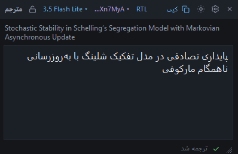
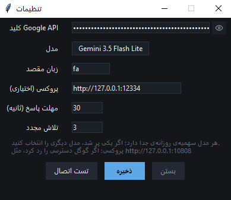

<div align="center">

# مترجم شناور (Floating Translator)

**یک پنجره‌ی کوچک و همیشه-رو (Always-on-Top) برای ترجمه‌ی فوری متن انتخاب‌شده در هر برنامه‌ی ویندوز — از جمله فایل‌های PDF.**

[](#)
[-3776AB?logo=python&logoColor=white)](#نسخه‌ی-پایتون-بدون-نیاز-به-نصب-پکیج)
[](#نسخه‌ی-بومی-ویندوز-با-rust)
[](#کلید-api-و-مدل‌های-پشتیبانی‌شده)

<br/>



</div>

---

## ویژگی‌های کلیدی

- **پنجره‌ی ثابت و بدون مزاحمت:** پنجره خودبه‌خود جابه‌جا نمی‌شود؛ فقط با کشیدن نوار عنوان حرکت می‌کند و موقعیت و ابعاد آن در `config.json` ذخیره می‌شود. با دکمه‌ی **«قفل»** می‌توانید جابه‌جایی را کامل قفل کنید.
- **پشتیبانی هوشمند از جهت متن (`RTL/LTR`):** سوییچ `RTL/LTR` در نوار عنوان (یا راست‌کلیک ← «جهت متن») چیدمان پاراگراف‌ها را فوراً تغییر می‌دهد و ذخیره می‌کند. حالت پیش‌فرض خودکار است: زبان‌های فارسی، عربی، عبری و اردو به‌صورت راست‌به‌چپ و سایر زبان‌ها چپ‌به‌راست نمایش داده می‌شوند.
- **کنترل ترجمه‌ی خودکار (`watch`):** از منوی راست‌کلیک ← «ترجمه‌ی خودکار انتخاب» می‌توانید ترجمه‌ی خودکار هنگام انتخاب متن را موقتاً خاموش کنید؛ در این حالت ترجمه‌ی کلیپ‌بورد و کپی همچنان فعال می‌مانند.
- **کپی سریع و خودکار (`autocopy`):** کپی کل ترجمه با دکمه‌ی **«کپی»** در نوار عنوان، منوی راست‌کلیک یا کلید میانبر `Ctrl+Shift+C`. همچنین با `Ctrl+C` روی پنجره، بخش انتخاب‌شده (یا کل متن) کپی می‌شود و با فعال‌سازی «کپی خودکار پس از هر ترجمه»، خروجی بلافاصله در کلیپ‌بورد قرار می‌گیرد.
- **مدیریت چند کلید API و پایش مصرف:** امکان افزودن چندین کلید، سوییچ سریع از نوار عنوان و مشاهده‌ی آمار محلی مصرف (`RPM` / `TPM` / `RPD`) برای هر کلید و مدل.
- **پایداری در شبکه‌های ناپایدار:** پشتیبانی از پروکسی HTTP، تنظیم مهلت پاسخ (`timeout`) و تلاش مجدد خودکار (`retries`) برای خطاهای گذرا.
- **دو نسخه‌ی مستقل:**
  1. **نسخه‌ی پایتون (`app.py`):** تنها با کتابخانه‌ی استاندارد پایتون (`tkinter`) و بدون نیاز به نصب هیچ پکیج جانبی.
  2. **نسخه‌ی بومی Rust (`rust-translator`):** پورت کامل با Win32 API، WinHTTP و GDI+ خالص (فایل اجرایی حدود ۴۳۰ کیلوبایت، بدون نیاز به پایتون).

---

## راه‌اندازی و اجرا

### نسخه‌ی پایتون (بدون نیاز به نصب پکیج)

1. روی `run.bat` دوبار کلیک کنید (یا از خط فرمان دستور `pythonw app.py` را اجرا کنید).
2. در اولین اجرا، پنجره‌ی تنظیمات باز می‌شود؛ **کلید Google API** خود را وارد کرده و **«ذخیره»** را بزنید.
3. در هر برنامه‌ای (مثل PDF Reader، مرورگر یا ویرایشگر متن) عبارتی را با ماوس انتخاب کنید یا روی یک کلمه دوبار کلیک کنید تا ترجمه بلافاصله نمایش داده شود.

<div align="center">

</div>

### نسخه‌ی بومی ویندوز با Rust

همان امکانات، پورت‌شده به Rust با Win32/GDI+ خالص و بدون وابستگی به Python. فایل `config.json` و `usage.json` کنار فایل اجرایی خوانده و ذخیره می‌شوند (در صورت هم‌مسیر بودن، با نسخه‌ی پایتونی مشترک است).

```powershell
cd rust-translator
cargo build --release
```

فایل خروجی در مسیر زیر ساخته می‌شود:

```text
rust-translator/target/release/floating-translator.exe
```

---

## میانبرها و کنترل‌های کاربری

| عمل | روش انجام |
|---|---|
| کپی کل ترجمه | دکمه‌ی **«کپی»** در نوار عنوان / راست‌کلیک ← «کپی ترجمه» / `Ctrl+Shift+C` |
| کپی بخشی از ترجمه | انتخاب با ماوس در پنجره + `Ctrl+C` |
| جابه‌جایی پنجره | کشیدن نوار عنوان (در صورت باز بودن قفل) |
| تغییر سریع مدل | کلیک روی نام مدل در نوار عنوان (کنار دکمه‌ی «قفل») |
| مدیریت کلیدها و مصرف | کلیک روی برچسب بنفش کلید در نوار عنوان ← «کلیدها و مصرف…» |
| منوی امکانات | راست‌کلیک روی پنجره (تنظیمات، کپی خودکار، ترجمه‌ی خودکار، قفل، خروج) |

---

## کلید API و مدل‌های پشتیبانی‌شده

با یک کلید از [Google AI Studio](https://aistudio.google.com/apikey) می‌توانید بین مدل‌های Gemini جابه‌جا شوید. سهمیه‌ی روزانه‌ی هر مدل مجزاست؛ بنابراین در صورت پر شدن سهمیه‌ی یک مدل (خطای `429`) می‌توانید بلافاصله مدل دیگری را انتخاب کنید.

| مدل | نوع کلید لازم |
|---|---|
| `Gemini 4 Hydrogen` *(پیش‌فرض)* | AI Studio |
| `Gemini 3.8 Flash` | AI Studio |
| `Gemini 3.7 Flash` | AI Studio |
| `Gemini 3.6 Flash` | AI Studio |
| `Gemini 3.5 Flash` / `3.5 Flash Lite` | AI Studio |
| `Gemini 3.1 Flash Lite` | AI Studio |
| `Gemini 3 Flash (preview)` | AI Studio |
| `Gemini 2.5 Flash` / `2.5 Flash Lite` | AI Studio |
| `Cloud Translation v2` | Google Cloud Console (فعال‌سازی **Cloud Translation API** + Billing) |

> **نکته:** مدل‌هایی که در AI Studio سهمیه‌ی رایگان ندارند (مانند خانواده‌ی Pro یا نسخه‌های `*-latest`) از فهرست حذف شده‌اند تا از خطای مداوم `429` جلوگیری شود. مدل‌های `Lite` معمولاً سهمیه‌ی روزانه‌ی بیشتری دارند.

---

## تنظیم پروکسی و پایداری اتصال

> **مهم برای کاربران ایران:** گوگل درخواست‌های `*.googleapis.com` از IP ایران را حتی با کلید معتبر با خطای **403** رد می‌کند. اگر با پیام «گوگل دسترسی این شبکه را رد کرد (403)» مواجه شدید، پروکسی یا VPN خود را تنظیم کنید.

1. راست‌کلیک روی پنجره ← **«تنظیمات…»**
2. در فیلد **پروکسی** آدرس HTTP پروکسی خود را وارد کنید (مثلاً `http://127.0.0.1:10809` یا بدون پیشوند به‌شکل `127.0.0.1:10809`).
3. دکمه‌ی **«تست اتصال»** را بزنید و پس از مشاهده‌ی ✓، **«ذخیره»** کنید.

<details>
<summary>پورت HTTP پیش‌فرض کلاینت‌های رایج و تنظیمات تلاش مجدد</summary>

فقط پروکسی **HTTP** پشتیبانی می‌شود (پورت SOCKS کار نمی‌کند). اگر VPN سیستمی (حالت TUN) روشن است، فیلد پروکسی را خالی بگذارید.

| کلاینت | پورت HTTP رایج |
|---|---|
| v2rayN / Xray | `10809` *(پورت `10808` برای SOCKS است)* |
| Clash / Clash Verge | `7890` |
| Hiddify | `12334` |
| nekobox / nekoray | `2081` |

**پایداری اتصال:**
- **مهلت پاسخ (`timeout`):** پیش‌فرض `20` ثانیه (برای VPN کند `30` تا `40` ثانیه پیشنهاد می‌شود).
- **تلاش مجدد (`retries`):** پیش‌فرض `2` بار (در کل ۳ درخواست با فاصله‌ی ۰٫۵ و ۱ ثانیه). فقط خطاهای گذرا (`timeout`، قطع اتصال، `429` و `5xx`) تکرار می‌شوند و خطاهای `400/401/403` برای جلوگیری از هدررفت سهمیه تکرار نمی‌شوند.

</details>

---

## پیکربندی (`config.json`) و امنیت

فایل `config.json` در اولین اجرا به‌صورت خودکار در کنار برنامه ساخته می‌شود و در `.gitignore` قرار دارد تا کلیدهای شما وارد مخزن گیت نشود:

```json
{
  "model": "gemini-4-hydrogen",
  "api_key": "YOUR_ACTIVE_API_KEY",
  "api_keys": ["YOUR_ACTIVE_API_KEY"],
  "target": "fa",
  "rtl": null,
  "autocopy": false,
  "watch": true,
  "proxy": "",
  "timeout": 20,
  "retries": 2,
  "opacity": 1.0,
  "x": 60,
  "y": 60,
  "locked": false
}
```

- `target`: کد زبان مقصد (`fa`، `en`، `tr` و ...). اگر متن انتخاب‌شده از قبل به زبان مقصد باشد، به‌صورت خودکار به انگلیسی ترجمه می‌شود.
- `opacity`: شفافیت پنجره بین `0.3` تا `1.0`.
- `usage.json`: آمار مصرف محلی را فقط با شناسه‌ی هش‌شده‌ی کلید (بدون ذخیره یا ارسال خود کلید) نگه می‌دارد و داده‌های قدیمی‌تر از ۲۴ ساعت پاک می‌شوند.

---

## معماری فنی و عیب‌یابی

<details>
<summary>نحوه‌ی تشخیص انتخاب متن، تفاوت نسخه‌ی Rust و دستورهای تست</summary>

### نحوه‌ی تشخیص انتخاب متن
هر ۱۵ میلی‌ثانیه وضعیت دکمه‌ی چپ ماوس و مختصات نشانگر خوانده می‌شود (`GetAsyncKeyState` / `GetCursorPos`). پس از رها شدن دکمه با جابه‌جایی حداقل ۸ پیکسل (یا دوبار کلیک روی یک نقطه)، `Ctrl+C` به پنجره‌ی فعال ارسال شده، متن از کلیپ‌بورد خوانده می‌شود و در یک ترد مجزا به API گوگل ارسال می‌گردد تا رابط کاربری هرگز قفل نشود.

عمداً از هوک سطح‌پایین (`WH_MOUSE_LL`) استفاده نشده است تا در صورت تأخیر پردازش، ویندوز هوک را بی‌صدا حذف نکند.

### تفاوت‌های عمدی نسخه‌ی Rust با نسخه‌ی پایتون
- منوی راست‌کلیک در نسخه‌ی Rust به‌صورت منوی کشویی بومی پیاده‌سازی شده است.
- پنجره‌های تنظیمات و مدیریت کلیدها دارای نوار عنوان سفارشی و هم‌تم هستند.
- در فیلدهای متنی نسخه‌ی Rust فقط کاراکترهای ASCII پذیرفته می‌شود (بدون IME).

### دستورهای تست و عیب‌یابی
- **نسخه‌ی پایتون:**
  - تست سلامت: `python app.py --selftest`
  - اجرای دیباگ (ثبت در `debug.log`): `python app.py --debug`
  - بررسی خطاهای راه‌اندازی: فایل `error.log` در کنار `app.py`
- **نسخه‌ی Rust:**
  - تست سلامت بدون رابط گرافیکی: `floating-translator.exe --selftest` (خروجی در `selftest.log`)
  - تست ترجمه از خط فرمان: `floating-translator.exe --translate "Hello"` (خروجی در `translate.log`)
  - بررسی کرش: فایل `panic.log` در کنار فایل اجرایی

### نکات مهم
- اگر برنامه‌ی هدف (مانند PDF Reader) با دسترسی **Administrator** اجرا شده باشد، ویندوز اجازه‌ی ارسال `Ctrl+C` را به برنامه‌ی عادی نمی‌دهد؛ در این حالت مترجم را نیز با دسترسی Administrator اجرا کنید یا از گزینه‌ی **«ترجمه‌ی کلیپ‌بورد»** در منوی راست‌کلیک استفاده کنید.
- برای اجرای خودکار هنگام روشن شدن ویندوز، یک Shortcut از `run.bat` (یا فایل اجرایی Rust) در پوشه‌ی `shell:startup` قرار دهید.

</details>

---

## مجوز و امضای دیجیتال (License & Code Signing)

- این پروژه تحت مجوز متن‌باز [MIT License](LICENSE) منتشر شده است.
- امضای دیجیتال رایگان نسخه‌های ویندوز توسط [SignPath.io](https://signpath.io/) و با گواهی [SignPath Foundation](https://signpath.org/) انجام می‌شود.

> Free code signing provided by [SignPath.io](https://signpath.io/), using a certificate by [SignPath Foundation](https://signpath.org/).
